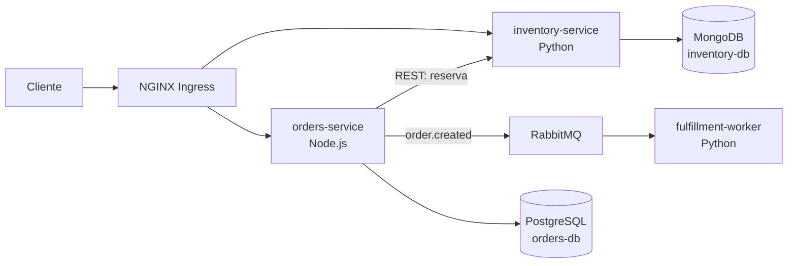

# Somativa N2 - Cloud Native

Exemplo de uma aplicacao de pedidos para demonstrar microsservicos, persistencia isolada, REST, RabbitMQ, Docker e Amazon EKS.

## Arquitetura



| Componente | Responsabilidade | Tecnologia | Persistencia |
| --- | --- | --- | --- |
| `orders-service` | Receber pedidos, reservar estoque por REST e publicar evento | Node.js, Express | PostgreSQL proprio |
| `inventory-service` | Consultar e reservar itens; identifica o Pod que respondeu | Python, FastAPI | MongoDB proprio |
| `fulfillment-worker` | Consumir `order.created` e processar/logar o evento | Python, RabbitMQ | Nao precisa persistir |

O exemplo contempla duas linguagens e dois SGBDs diferentes. Cada servico que persiste dados possui seu proprio banco; nenhum servico acessa diretamente o banco do outro. O estoque inicial de demonstracao e `SKU-001` (100 unidades) e `SKU-002` (50 unidades).

## Executar localmente

Prerequisitos: Docker Desktop com Docker Compose.

```powershell
docker compose up --build
```

Em outro terminal, crie um pedido:

```powershell
$body = @{ sku = 'SKU-001'; quantity = 2; customer = 'Ana' } | ConvertTo-Json
Invoke-RestMethod -Method Post -Uri http://localhost:3000/api/orders -ContentType 'application/json' -Body $body
Invoke-RestMethod http://localhost:3000/api/orders
Invoke-RestMethod http://localhost:8000/items
docker compose logs -f fulfillment-worker
```

O retorno do pedido mostra `inventory_pod` e `orders_pod`. Para observar o Service Kubernetes distribuindo requisicoes, repita `GET /items` depois de escalar o estoque no cluster; o campo `served_by` identifica o Pod.

URLs locais: pedidos `http://localhost:3000/api/orders`, estoque `http://localhost:8000/items` e painel RabbitMQ `http://localhost:15672` (`somativa` / `somativa-demo`).

## Deploy no Amazon EKS

1. Crie um cluster EKS com nodes, configure `kubectl` para esse cluster e instale o NGINX Ingress Controller. A instalacao do controller pode seguir o guia oficial da versao escolhida: https://kubernetes.github.io/ingress-nginx/deploy/.
2. Crie um repositorio ECR por imagem e autentique o Docker na sua regiao AWS.
3. Na raiz do projeto, construa e envie as imagens (substitua conta e regiao):

```powershell
$registry = '<ACCOUNT_ID>.dkr.ecr.<REGION>.amazonaws.com'
aws ecr get-login-password --region <REGION> | docker login --username AWS --password-stdin $registry
docker build -t "$registry/somativa-orders:latest" ./services/orders
docker build -t "$registry/somativa-inventory:latest" ./services/inventory
docker build -t "$registry/somativa-fulfillment:latest" ./services/fulfillment
docker push "$registry/somativa-orders:latest"
docker push "$registry/somativa-inventory:latest"
docker push "$registry/somativa-fulfillment:latest"
```

4. Edite `k8s/20-apps.yaml`, trocando `<ACCOUNT_ID>` e `<REGION>` nos tres campos `image` pelas referencias ECR reais. Em seguida aplique os manifestos:

```powershell
kubectl apply -f k8s/00-namespace.yaml
kubectl apply -f k8s/01-config.yaml
kubectl apply -f k8s/02-secret.example.yaml
kubectl apply -f k8s/10-data-services.yaml
kubectl apply -f k8s/20-apps.yaml
kubectl apply -f k8s/30-ingress.yaml
kubectl -n somativa-n2 get pods,svc,ingress
```

O Secret versionado contem credenciais exclusivamente para demonstracao academica. Troque-as antes de expor o cluster e nao reutilize esses valores em ambientes reais.

5. Aguarde os Pods ficarem `Ready`, confira o endereco com `kubectl -n somativa-n2 get ingress` e use o IP/hostname do Ingress:

```powershell
$base = 'http://<INGRESS_ADDRESS>'
$body = @{ sku = 'SKU-001'; quantity = 2; customer = 'Ana' } | ConvertTo-Json
Invoke-RestMethod -Method Post -Uri "$base/api/orders" -ContentType 'application/json' -Body $body
Invoke-RestMethod "$base/api/inventory/items"
kubectl -n somativa-n2 logs deploy/fulfillment-worker -f
```

O Ingress deste exemplo usa HTTP para facilitar a demonstracao. Para acesso publico real, configure DNS, TLS e credenciais seguras.

## Evidencias para a apresentacao

- **Responsabilidades e autoria:** cada integrante deve assumir, adaptar e explicar o microsservico que implementou; o grupo precisa registrar quem ficou responsavel por cada servico.
- **Docker/EKS:** `kubectl -n somativa-n2 get deploy,pods,svc` mostra Deployments, Pods e Services.
- **Database per Service:** mostre `orders-db` usado somente por `orders-service` e `inventory-db` usado somente por `inventory-service`.
- **REST + Service Discovery:** crie um pedido; `orders-service` chama `http://inventory-service:8000` pelo DNS do Service Kubernetes.
- **RabbitMQ:** acompanhe `kubectl -n somativa-n2 logs deploy/fulfillment-worker -f` ao criar pedidos. O consumidor confirma o processamento do evento.
- **Escala e balanceamento:** use `kubectl -n somativa-n2 scale deployment/inventory-service --replicas=3` e consulte varias vezes `/api/inventory/items`; compare `served_by`. O manifesto ja inicia com tres replicas.
- **Ingress:** demonstre `/api/orders` e `/api/inventory/items` no endereco do balanceador NGINX.

## Limites do exemplo

Este repositorio fornece o codigo, containers e manifests, mas nao cria uma conta AWS, cluster EKS, imagens ECR ou endereco publico. Esses passos exigem acesso e recursos da conta da equipe. Antes da avaliacao, confirme custos AWS, estado `Ready` dos componentes e acesso de rede ao balanceador.